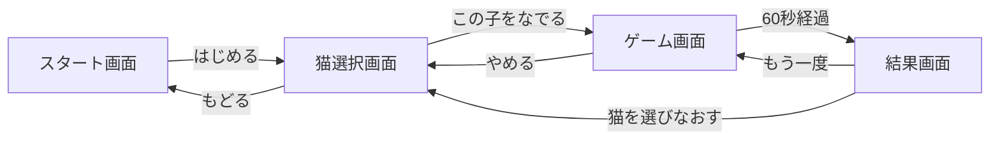

# ねこなでなで 設計書

## 1. 概要

表示された猫をタップ（なでなで）してハートを稼ぐブラウザゲーム。

- 猫ごとに「なでなでポイント（好きな場所）」が違い、嫌な場所をタップすると怒ってハートが減る
- 「ごきげんゲージ」があり、低いときはなでなでポイントでも怒ってハートが減る
- ごきげんゲージは猫ごとに変動し、基本的に連打すると下がる
- 制限時間 60 秒。終了すると結果画面で稼いだハート数を表示する

ベースは `cat_pet_game (1).html`（SVG の茶トラ猫、部位ごとの当たり判定、ごきげんゲージ）。

## 2. 技術構成

ビルド不要の素の HTML / CSS / JavaScript。`index.html` をブラウザで直接開けば動く（`file://` で動くよう ES Modules は使わず通常の `<script>` で読み込む）。

| ファイル | 役割 |
| --- | --- |
| `index.html` | 画面（スタート / 猫選択 / ゲーム / 結果）のマークアップ |
| `style.css` | スタイル |
| `js/cats.js` | 猫データ（パラメータ・セリフ・SVG パーツ）と SVG 組み立て関数。`window.NekoData` に公開 |
| `js/game.js` | 画面遷移・ゲームループ・タップ判定・ハイスコア保存 |

バランス調整は基本的に `js/cats.js` の数値だけを触れば済むようにする。

## 3. 画面遷移

### 3.1 スタート画面
- タイトル、猫のイラスト、遊び方（箇条書き）、「はじめる」ボタン

### 3.2 猫選択画面
- 3 匹のカード（イラスト、難易度、呼び名、品種・性別・年齢、説明、なでなでポイント、ごきげんの性格、ベストスコア）
- 「この子をなでる」でゲーム開始

### 3.3 ゲーム画面
- 呼び名、その下に品種・性別・年齢、難易度、ハート数、残り時間、ごきげんゲージ（不機嫌ラインを線で表示）
- 猫のイラスト（タップ領域）
- 警告表示、猫のセリフ、なでなでポイントの案内
- 「やめる」ボタン（猫選択へ戻る。スコアは保存しない）

### 3.4 結果画面
- 猫のイラスト、呼び名、品種・性別・年齢、難易度、稼いだハート数、その猫のハイスコア（更新時は「新記録！」）
- 「もう一度」（同じ猫で再開）、「猫を選びなおす」

## 4. 操作

- タップ（クリック）のみ。1 回のタップ = 1 回のなでなで
- `pointerdown` で判定。なぞり（ドラッグ）は判定しない
- 当たり判定は SVG 内の透明な部位領域（`data-zone`）で行う。部位外のタップは無視

### 部位一覧

| ID | 表示名 |
| --- | --- |
| `head` | 頭の上 |
| `face` | ほっぺ |
| `chin` | あごの下 |
| `back` | 背中 |
| `belly` | お腹 |
| `paws` | あし |
| `tail` | しっぽ |

## 5. ゲームルール

### 5.1 共通

| 項目 | 値 |
| --- | --- |
| 制限時間 | 60 秒 |
| ごきげんゲージ | 0〜100 |
| 不機嫌ライン | 30（これ未満はどこをなでても怒る） |
| ハートの下限 | 0（マイナスにはならない） |

### 5.2 タップ時の判定（上から順に評価）

1. **ごきげん < 不機嫌ライン** → 怒る。ハート `-hearts.angry`、ごきげん `-5`
2. **好きな場所ではない** → 怒る。ハート `-hearts.bad`、ごきげん `-dislikePenalty`
3. **連打**（前回タップから `rapidMs` 未満） → ハート `+hearts.good`、ごきげん `-rapidPenalty`
4. **ゆっくりなでた** → ハート `+hearts.good`、ごきげん `+calmGain`

怒ったときは約 1.2 秒間、怒り顔を表示する。

### 5.3 ごきげんゲージの自然変化

毎フレーム、ごきげんは猫ごとの「基準値」に向かって `drift`（/秒）の速さで近づく。
触らずにいれば基準値に戻り、なでて基準値より上げても徐々に基準値へ戻る。

基準値の種類:

- `fixed`: 一定値
- `wave`: `center + amplitude * sin(2π * 経過秒 / period)` で上下する
- `whim`（気まぐれタイム、任意）: `every` 秒（ランダム範囲）ごとに `duration` 秒間だけ基準値が `value` になる

### 5.4 表情

| 状態 | 条件 |
| --- | --- |
| 怒り顔（しっぽ速振り、💢） | 怒った直後 1.2 秒間、またはごきげん < 30 |
| にっこり | 怒っておらず、ごきげん ≥ 75 |
| 通常 | 上記以外 |

ごきげんの表示: 75 以上「ごろごろ 😻」、50 以上「ふつう 😺」、30 以上「そわそわ 😼」、30 未満「ごきげんななめ 😾」

## 6. 猫ごとのパラメータ

| 項目 | マンチカン | MIX | マヌルネコ |
| --- | --- | --- | --- |
| 呼び名 | ナイト君 | さくらちゃん | ジョニー君 |
| 性別 | 男の子 | 女の子 | 男の子 |
| 年齢 | 1歳 | 3歳 | 5歳 |
| 難易度 | 初心者向け | 中級者向け | 上級者向け |
| なでなでポイント | 全身 | 頭の上・あごの下 | 頭の上 |
| 開始時ごきげん | 85 | 55 | 32 |
| 基準値 | fixed 85 | wave 中心55 振幅30 周期10秒（25〜85） | fixed 32 ＋ 気まぐれタイム |
| 気まぐれタイム | なし | なし | 8〜14 秒ごとに 6 秒間、基準値 70 |
| drift（/秒） | 6 | 5 | 6 |
| 連打判定 `rapidMs` | 350ms | 600ms | 900ms |
| 連打ペナルティ | -4 | -12 | -15 |
| ゆっくりなでた時 `calmGain` | +3 | +4 | +5 |
| 嫌な場所ペナルティ | -（嫌な場所なし） | -15 | -20 |
| ハート（好きな場所） | +2 | +3 | +5 |
| ハート（嫌な場所） | -（嫌な場所なし） | -3 | -5 |
| ハート（不機嫌時） | -3 | -4 | -5 |

補足:

- マヌルネコの基準値は当初案 25 から 32 に調整した。25 だと気まぐれタイム以外はなでた瞬間に必ず怒るため、「不機嫌ラインぎりぎりで、ゆっくりなでれば何とか耐える」難しさにしている
- 難しい猫ほど 1 回あたりのハートを多くし、上手になでたときの見返りを大きくしている

### 見た目

| 猫 | 見た目の特徴 |
| --- | --- |
| マンチカン | 茶トラ、短い脚、丸い目 |
| MIX | キジトラ短毛（くすんだグレー茶＋濃いしま）、普通の脚、緑の目、しま模様のしっぽ |
| マヌルネコ | 灰色、横に広い顔、低く平たい耳、黄色い丸い目、ほっぺのしま、額の黒い点、しま模様で先が黒いしっぽ |

共通の骨格（体・頭の位置、当たり判定）に猫ごとのパーツ（耳・目・模様・しっぽ・毛並み）を差し込んで SVG を組み立てる。

## 7. ハイスコア

- `localStorage` に猫ごとに保存（キー: `neko_nadenade.best.<猫ID>`）
- 結果画面でハイスコアを表示し、更新時は「新記録！」
- 猫選択画面のカードにもベストを表示
- `localStorage` が使えない環境では保存せず 0 扱い
